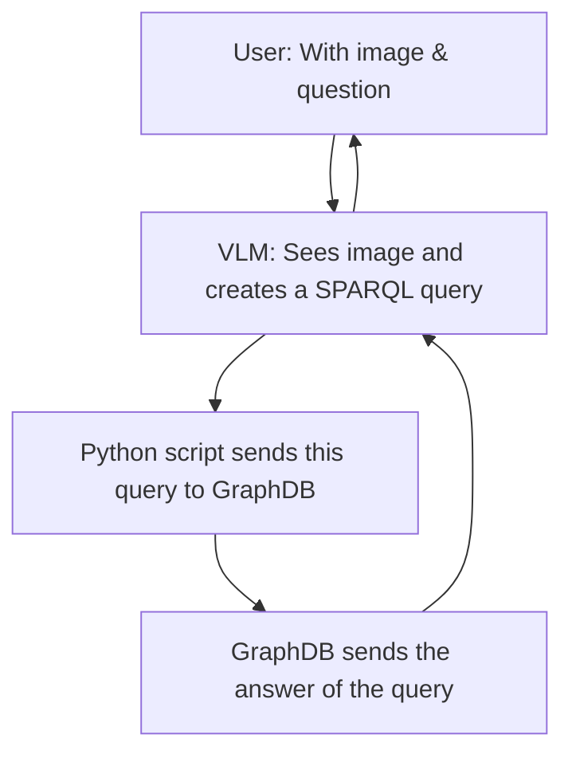

# RAG

I think you use RAG, when you want bring company's data into the game. For example through company's documents.

## Strategy

In production RAG engineering, At first, teams establish **a foundational data pipeline** during the ingestion phase by implementing **Hybrid Search** (dense and sparse vectors) alongside an **appropriate chunking strategy**. 

Subsequently, based on **evaluation metrics and user feedback**, engineers iteratively introduce and tune query-time components—such as Cross-Encoder Rerankers and Query Transformation—directly within the retrieval pipeline to maximize precision without re-indexing the vector database.

## Vector Databases

Before data is stored in a vector database, it is passed through a pre-trained deep learning model—known as an embedding model—**strictly for inference**. During this forward pass, the model does not train or update its weights; instead, it extracts the semantic meaning of the raw input and encodes it into a dense numerical vector representation ready for indexing.

Vector databases do not contain deep neural networks; embedding models are separate components that generate the numerical vectors before storage. 

###  Different Models
Different vector databases (such as **Pinecone, Qdrant, Milvus, and Chroma**) are primarily distinguished by their **data engineering architecture and retrieval mechanisms**:

- **Indexing Algorithms**: The mathematical structures used to organize vectors for fast Approximate Nearest Neighbor (ANN) search (e.g., HNSW, IVF).
- **Storage and Scalability**: How data is stored (in-memory vs. disk-based), distributed across nodes, and deployed (fully managed cloud vs. open-source self-hosted).
- **Filtering and Hybrid Search**: Efficiency in applying metadata filters during retrieval and combining semantic search with traditional keyword search.
- **Memory Optimization**: Compression techniques (such as quantization) used to reduce RAM consumption while preserving search accuracy.

#### Different Deep Learning models

Here are the most widely used, industry-standard embedding models for generating vectors prior to storage in a vector database:

* **OpenAI (`text-embedding-3-large` / `text-embedding-3-small`):** The industry standard for commercial APIs, offering high semantic accuracy and flexible dimensionality (Matryoshka Representation Learning).
* **Cohere (`embed-v3`):** Widely adopted in enterprise RAG systems, particularly strong in multilingual retrieval and native compression support.
* **BAAI / BGE (`bge-m3` / `bge-large-en-v1.5`):** Leading open-source embedding models heavily used in self-hosted production pipelines for dense, sparse, and multi-vector retrieval.
* **NVIDIA (`NV-Embed-v2`):** A top-performing open-weight model based on Mistral, frequently deployed in high-accuracy enterprise search architectures.
* **Sentence-Transformers (`E5-mistral-7b-instruct` / `all-MiniLM-L6-v2`):** Standard open-source models for self-hosted environments—`E5` for high-precision retrieval and `MiniLM` for ultra-low-latency CPU inference.
* **Voyage AI (`voyage-3` / `voyage-code-3`):** Specialized commercial models favored in technical and code-retrieval production pipelines.

## Vanilla RAG
There is no graph between documents, the system works just based on the similarity between data. 

## GraphRAG

The GraphRAG application pipeline:

The whole pipeline:
Decoupling of the Offline Phase (Knowledge Base Preparation) and the Online Phase (Inference)

* Offline Phase / Knowledge Base Preparation:
    * Step 1 (Knowledge Graph Construction): This phase consists purely of constructing, structuring, and ingesting RDF knowledge triples into GraphDB (without updating model weights). This process is executed once offline to establish the non-parametric memory of the architecture.

* Online Phase / Real-Time Inference Pipeline:
    * Step 2 (Entity Extraction): Upon receiving a new image and query, the pre-trained Vision-Language Model (e.g., Qwen2-VL) extracts visual concepts and grounded entities during the forward inference pass.
    * Step 3 (SPARQL Query Generation): The model or pipeline dynamically constructs the corresponding SPARQL query via in-context prompting strategies (such as Few-Shot In-Context Learning).
    * Step 4 (Graph Retrieval): The generated query is executed against GraphDB to retrieve relevant relational triples linked to the visual input in real time.
    * Step 5 (Grounded Response Generation): Conditioning on the augmented prompt (comprising the input image, user question, and retrieved triples), the model generates the grounded, verified final response within the same inference phase.

**Prompt engineering** is designing prompts when we are talking to LLM/VLM model. This happens **2 times** in the pipeline. First is when we are getting SPARQL queries to send them to GraphDB and the second is when we got the answer from GraphDB and we want to tell LLM/VLM instructions on how to work with this answer.

### Different Graph DBs
Graph databases are broadly divided into dozens of implementations across two primary architectural paradigms:

* **Labeled Property Graphs (LPG):** **Neo4j** is the most prominent engine in this category, utilizing the **Cypher** query language rather than the RDF standard. Other notable LPG engines include **Amazon Neptune**, **Memgraph**, and **TigerGraph**.
* **Semantic Web Graph Stores (RDF Triplestores):** These natively adhere to the **W3C RDF** standard and utilize **SPARQL** for querying, which matches the requirements of your project. Key implementations include:
* **Ontotext GraphDB** (the specific enterprise product bearing this name)
* **Apache Jena (TDB / Fuseki)**
* **OpenLink Virtuoso**
* **Blazegraph**
* **Stardog**

#### ArangoDB
ArangoDB is a native multi-model NoSQL database that implements a **Labeled Property Graph (LPG)** model, rather than an RDF triple store.
* **Data Model:** It unifies three core storage paradigms—Document (JSON-like VelocyPack documents), Key-Value, and Graph—under a single database engine.
* **Graph Structure (LPG):**
    * **Vertices (Nodes):** Stored as discrete JSON documents within standard document collections.
    * **Edges (Relations):** Stored in specialized *Edge Collections*. Each edge is a complete JSON document containing mandatory `_from` and `_to` pointer attributes referencing vertex IDs, and it can store arbitrary metadata properties (e.g., weights, timestamps, relation types).
* **Query Language:** It uses **AQL (ArangoDB Query Language)**, a declarative language that allows developers to run document filters, aggregations, full-text searches, and complex graph traversals ($k$-hop depth/breadth exploration) within a single unified query.
* **RDF vs. LPG Distinction:** It does not use W3C Semantic Web standards (no SPARQL, no native RDF triplet structures) and does not have a built-in OWL/RDFS formal logic reasoning engine. Instead, it relies on flexible graph traversal and document indexing.

In summary, while Neo4j is indeed a graph database, it belongs to the LPG category and does not natively run SPARQL. For a Knowledge-Grounded Multimodal RAG pipeline built on RDF specifications, **Ontotext GraphDB** or **Apache Jena** is the standard choice.

## Advanced RAG \ Naive RAG
* **Naive RAG (Traditional / Baseline Retrieval):** A straightforward linear pipeline that embeds the user query, performs vector similarity search against a Vector DB, and passes the top-$K$ chunks directly to the LLM. While simple to implement, it often introduces high noise, struggles with multi-hop reasoning, and overlooks structured entity relationships.

* **Advanced RAG (Modular & Grounded Orchestration):** An enhanced paradigm that transforms the linear retrieval process into an intelligent, structured, and multi-stage workflow. It integrates semantic knowledge structures, agentic decision-making, and pre/post-retrieval optimizations to guarantee deterministic, hallucination-free generation.

### Four Core Architectural Archetypes of Advanced RAG
* **1. GraphRAG (Knowledge-Grounded Retrieval):**
Combines vector search with structured Knowledge Graphs (RDF/SPARQL or property graphs like Neo4j). It enables multi-hop reasoning across complex entity hierarchies and grounds generation in domain ontologies to eliminate factual hallucinations.

* **2. Agentic RAG (Dynamic & Multi-Step Orchestration):**
Employs the LLM as an autonomous agent to evaluate query intent dynamically. It autonomously decomposes complex questions into sub-tasks, performs iterative searches, and calls external tools/databases via protocols like MCP.

* **3. Modular RAG (Pre-Retrieval & Post-Retrieval Pipeline):**
Refines the end-to-end retrieval stages independently. It applies **Pre-retrieval** transformations (such as Query Expansion, HyDE, or Sub-query decomposition) and **Post-retrieval** refinements (such as neural Rerankers and context summarization) to maximize information density before reaching the generator.

* **4. Self-Reflective / Corrective RAG (CRAG & Self-RAG):**
Embeds automated evaluation loops into the retrieval cycle. An evaluator model evaluates whether the retrieved passages are relevant and factual; if retrieval quality falls below a threshold, the system triggers corrective query reformulations or falls back to supplementary web search.
