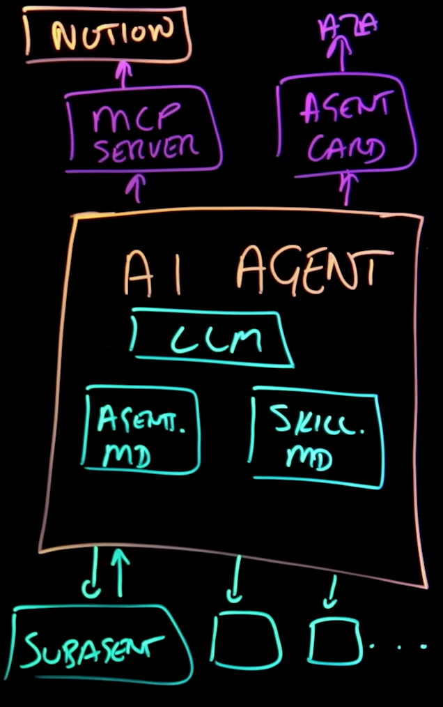
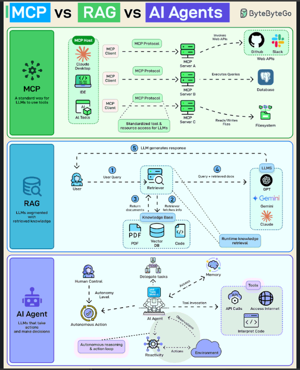

# AI Engineering

The discipline of transforming **existing foundation models** (LLMs/VLMs) into robust, deterministic, secure, and production-ready software systems **connected to** enterprise data and tools.

An AI Engineer **doesn't** train a model from scratch.

Apparently LangGraph plays a key-role in this field, specially in multi-agent architectures. 

Topics:
- [Ollama](https://github.com/parsaeisa/Notes/blob/main/AI/AI%20Engineering/Ollama.md)
- [LlamaIndex](https://github.com/parsaeisa/Notes/blob/main/AI/AI%20Engineering/LlamaIndex.md)

## Personal Notes

You've always asked AI in their online platform, person-in-person, that is old now. I know, it was for just 2 years ago, but, it's old! You should always think about how automate different operations using Agents. Let AI do your job! Even if you get fired, you have something to show to the next Company about your AI engineering skills. 

## Problems that can be solved only with Agentic Workflows

An **Agentic Workflow** is essential when a task involves **non-linear planning, dynamic tool integration, multi-step execution loops, and automated self-correction**. Without an agentic architecture, these tasks become exceptionally **slow, error-prone, and heavily** reliant on manual human intervention.

| # | Use Case Category | Primary Failure Mode Without Agents | Core Agentic Capability |
| :--- | :--- | :--- | :--- |
| **1** | Automated Code Debugging & Refactoring | Human copy-pastes stack traces repeatedly | Autonomous test-driven execution loops |
| **2** | Deep Multi-Source Research & Synthesis | Generates shallow, unverified text summaries | Parallel task decomposition & critic loops |
| **3** | End-to-End Operational Customer Support | Bot is limited to static FAQs; requires human transfer | Multi-API execution (CRM, Refund, Inventory) |
| **4** | Automated API Migration & Refactoring | Manual cross-file refactoring and build debugging | Dependency mapping & incremental compilation loops |
| **5** | Heterogeneous Document Reconciliation | High OCR/parsing errors require manual review | Rule-based validation & dynamic tool switching |
| **6** | Incident Triage & Infrastructure Remediation | Slow manual log investigation during outages | Automated context gathering & guarded remediation |

### 1. Automated Code Debugging & Refactoring
* **The Non-Agentic Bottleneck:** Standard LLMs generate code in a single turn. When dealing with complex runtime errors or failing test suites across a large codebase, a human must manually copy the code into an IDE, run tests, copy back the new error logs, and prompt the LLM again—creating an exhausting, high-latency manual loop.
* **The Agentic Solution:** An agent uses code execution sandboxes (e.g., E2B, Docker) and terminal tools to autonomously analyze stack traces, edit codebase files, execute test suites (`pytest`, `npm test`), inspect output logs, and iteratively refactor until all tests pass.

### 2. Deep Multi-Source Research & Synthesis
* **The Non-Agentic Bottleneck:** Single-prompt LLMs provide high-level, generic summaries. Deep research requires dozens of manual search queries, cross-checking conflicting financial/academic data, extracting tables, and filtering out hallucinations.
* **The Agentic Solution:** Utilizes a **Multi-Agent Orchestration Pattern** (Supervisor/Sub-agents):
  * **Planner Agent:** Decomposes the research topic into specialized sub-queries.
  * **Search/Scraper Agents:** Concurrently retrieve data from live web search APIs (e.g., Tavily, Exa) and filter noise.
  * **Critic Agent:** Audits facts, detects logical contradictions, and requests targeted re-searches before a Writer Agent compiles the final report.

### 3. End-to-End Operational Customer Support
* **The Non-Agentic Bottleneck:** Standard chatbots answer informational FAQs but cannot execute state-changing actions. Complex tickets (e.g., duplicate charges needing cancellation and refund) get transferred to human support queues, leading to resolution delays of hours or days.
* **The Agentic Solution:** Agents leverage **Function Calling & API Tools** to query internal databases (CRM), verify transaction history, execute payment gateway refunds via API, update inventory systems, and notify the user with a tracking ID—resolving complex issues autonomously in seconds.

### 4. Automated API Migration & Refactoring
* **The Non-Agentic Bottleneck:** Upgrading a major SDK or breaking-change API across a enterprise codebase with dozens of dependent files requires manual identification, editing, and compilation testing file by file.
* **The Agentic Solution:** The agent reads breaking-change documentation, scans the entire codebase for deprecated signatures, applies edits across dependent files, runs build scripts, isolates syntax/link errors, and iteratively fixes the code until the build compiles successfully.

### 5. Heterogeneous Document Extraction & Reconciliation
* **The Non-Agentic Bottleneck:** Extracting financial or operational data from unpredictable formats (scanned PDFs, invoice images, raw emails, spreadsheets) often yields parsing/OCR errors that pollute downstream databases if not manually audited by humans line by line.
* **The Agentic Solution:** Incorporates **Deterministic Validation & Tool Switching**:
  1. Parses documents using OCR/Vision tools.
  2. Runs programmatic math reconciliation (e.g., checking if line items equal the invoice total) and schema validation (e.g., Pydantic).
  3. Dynamically switches to a higher-precision vision model if validation fails, or routes low-confidence fields to a Human-in-the-Loop (HITL) queue.

### 6. Automated Incident Triage & Infrastructure Remediation
* **The Non-Agentic Bottleneck:** During production outages or security alerts, DevOps engineers spend critical time manually pulling logs, checking metrics, formulating hypotheses, and executing CLI commands to diagnose root causes—costing extended downtime.
* **The Agentic Solution:** Upon receiving a monitoring Webhook (e.g., Prometheus, Datadog), the agent autonomously queries log aggregators, identifies root causes, selects scoped infrastructure tools (e.g., Kubernetes API, Cloud CLI), executes guarded remediation actions (e.g., restarting crashed pods, blocking malicious IPs), and verifies service health post-fix.

## Core Scope of Modern AI Engineering

* **Data Engineering & Ingestion Pipelines:** Preparing high-quality datasets, preventing data leakage, and implementing robust document chunking and indexing strategies.

* **Semantic Grounding & Knowledge Integration:** Integrating Knowledge Graphs and ontologies (e.g., RDF, GraphRAG) to bridge the gap between probabilistic model outputs and deterministic domain requirements, ensuring factual accuracy.

* **Orchestration & Agentic Architectures:** Designing cyclic agentic workflows and tool-calling state machines using frameworks such as LangGraph, LlamaIndex, and LangChain.

* **Standardized System Interoperability:** Implementing standardized communication protocols (such as Model Context Protocol - MCP) to expose enterprise context, tools, and execution environments to foundation models.

* **AI Operations (MLOps) & Evaluation:** Tracking experiments and parameters (W&B / MLflow), performing model quantization/compression, profiling GPU memory, and running rigorous evaluation suites (e.g., Ragas, eval-driven development).

* **Serving, Optimization & Deployment:** Packaging models and pipelines in Docker containers, optimizing runtime throughput with TensorRT / ONNX, and exposing production-ready APIs via FastAPI or Triton Inference Server.

* **Context & Software Layer Abstraction:** Building resilient software wrappers and orchestration layers around pretrained foundation models, delivering scalable, deterministic enterprise systems rather than training models from scratch.

## Teminology

New terms:
- Prompt Engineering
- Context Engineering: I think it has Tool calling, MCP and RAG around the prompt engineering
    - Context window
- Agent Harness
- Agent.md
- Skill.md
- MCP: AI agent connecting to data on another server
- A2A: AI agent talking to another AI agent. 
- Sub-agents: Small agents working parallel. We could have many of them. 



### MCP vs RAG vs AI Agent


| Dimension | AI Agent | Model Context Protocol (MCP) |
| :--- | :--- | :--- |
| **Core Nature** | Autonomous decision-maker & reasoning entity (LLM-driven brain)[cite: 1, 2]. | Open, standardized communication protocol & interface layer (middleware)[cite: 1, 2]. |
| **Primary Role** | Multi-step planning, state management, reflection, and dynamic goal execution[cite: 1, 2]. | Exposing structured tools, resources, and contexts across systems via a universal schema[cite: 1, 2]. |
| **Focus** | **"What"** action to take next based on logic and context[cite: 2]. | **"How"** tools and host applications connect without custom glue code[cite: 1, 2]. |

#### The Driving Analogy

* **The AI Agent is the Driver:** It observes the road, evaluates conditions, plans routes, decides when to accelerate or brake, and navigates obstacles dynamically.
* **MCP is the Cockpit Interface (Steering Wheel, Pedals & Gearbox):** Standardized, uniform mechanical interfaces that connect the driver's intent to the car’s underlying hardware. Regardless of whether the car runs on petrol or electricity, the pedals and steering wheel operate identically, preventing the driver from needing to rewire the engine just to steer.

## The structure of an AI Agent

In standard system architecture, an AI Agent comprises three core components:
* **Reasoning Core:** A foundation model (LLM / VLM) responsible for intent parsing, multi-step planning, and decision-making.
* **Memory & Knowledge Store:** A structured knowledge layer (e.g., Graph Database / Knowledge Graph) that supplies relational context, grounded facts, and long-term state.
* **Tools & Actuators:** Standardized interfaces and protocol endpoints (e.g., ERI, REST APIs, or execution runtimes) allowing the agent to perform actions and query distributed servers.

## MCP

It is a protocol which connects our Agent to different tools and platforms. 

On one side we can have different LLMs such as Claude, Gemini, Chat GPT and on the other side we have different tools such as Github, PostgreSQL, Slack, etc. You can **swap AI models** much faster with it.

You may say why they are not using HTTP to connect to other tools, the answer is HTTP request has so many **irrelevant** parameters but MCP keeps the answer it gets from other places clean and relevant. It gives the LLM all it needs. MCP returns simplified LLM-friendly response:
```
{
  "content": [
    {
      "type": "text",
      "text": "Pod my-app is Running (3/3 containers ready). Node: worker-node-1. Uptime: 2 hours. No restarts."
    }
  ]
}
```
So it's **not** more powerful than API, just more concrete.

One other difference between MCP and API is that the MCP has a memory, so it is **stateful**, unlike APIs which are stateless. MCP keeps a context. 

With APIs you need to manage API keys for each API which you call, but MCP keeps all the API keys of all APIs and handles them for the LLM. the AI Agent doesn't see any API keys or secrets. The MCP adds authentication headers. Actually the term **Context** in MCP stands for keeping the context(state) of the conversation.

### Architecture
- MCP server: The translator
- MCP client: sits **next to AI Agent** on the **host**. MCP client is the one who talks to MCP server, the AI Agent just makes it human friendly (in both recieveing from user and responding to user). MCP client sends a tools\call request to the MCP server.
- AI Agent: It just state the intent. 
- Host: The host executes different functions. 

### MCP servers

3 Types of MCP servers:
- Community driven or Open-source: Good for starting
- Enterprise MCP serves: A gold standards because they are built by the tool companies themeselves.
- Community servers

## Tools

LangChain, LlamaIndex: Orchestration Tools
- LlamaIndex: A Data and AI orchestration tool which loads documents (PDFs, Databases), turns them into vectors, indexes them and connects them to LLMs/VLMs.

- Evaluation Tools: TruLens & Ragas
- Document processing & Conversion: Docling, Marker
- Ollama: Deploying tools
- n8n

### Evaluation Tools

Evaluation frameworks such as Ragas and TruLens can be used **just after integrating GraphDB**, rather than during the baseline phase. These frameworks evaluate the **alignment between** an injected retrieval context and the generated answer.

* **Applicability Stage:** Deploy Ragas or TruLens only in the KG-augmented pipeline to assess retrieval quality and grounding.
* **Faithfulness Assessment:** Quantifies whether the VLM output is strictly grounded in the SPARQL-retrieved triples rather than driven by parametric hallucinations.
* **Context Relevance:** Evaluates the semantic utility of the retrieved knowledge graph facts relative to the image and query.
* **Benchmark Accuracy Metric:** These frameworks evaluate RAG triaging dynamics, not direct dataset correctness; computing official task performance against human annotations still requires the standard OK-VQA consensus metric.

The above metrics are undefined without graph-retrieved triples in the prompt.

## Prompt-Engineering Example

In production automotive systems such as Mercedes-Benz MBUX, prompt engineering grounds free-form speech into structured, safety-constrained API calls for vehicle electronic control units (ECUs).

**Raw Driver Input:**

> "It's freezing in here! Also, find a gas station along the route that has premium fuel."

Sending this input without conditioning produces conversational text unsuitable for real-time vehicular control. A system prompt establishes strict functional constraints:

Engineered System Prompt:
```text
[SYSTEM]
You are the MBUX in-cabin orchestrator for a Mercedes-Benz vehicle.
Your goal is to parse natural-language driver intents into discrete, validated vehicle control API calls.

CRITICAL CONSTRAINTS:
1. Output ONLY a valid JSON object matching the defined schema. No conversational filler, no markdown wrapping outside the JSON.
2. Safety Priority: Never adjust parameters beyond physical safety thresholds (HVAC bounds: 16.0°C to 28.0°C).
3. Ambiguity Handling: If the target temperature is unspecified, increment/decrement by 2.0°C from CURRENT_STATE.

[VEHICLE_TELEMETRY]
- current_cabin_temp: 19.5 C
- current_fuel_level: 18 %
- current_gps: "48.7758, 9.1829" (Stuttgart, Germany)

[AVAILABLE_APIS]
- HVAC_SetTemperature(zone: string, target_celsius: float)
- NAV_SearchAlongRoute(category: string, filter_tag: string)

[FEW-SHOT EXAMPLES]
User: "A bit chilly in here."
Output:
{
  "actions": [
    {"api": "HVAC_SetTemperature", "params": {"zone": "all", "target_celsius": 21.5}}
  ],
  "driver_feedback_tts": "Increasing cabin temperature to 21.5 degrees."
}

[INPUT]
User: "هوا خیلی سرده، یخ زدم! راستی یه پمپ‌بنزین هم تو مسیر پیدا کن که بنزین سوپر داشته باشه."
```

Deterministic Model Output:
```json
{
  "actions": [
    {
      "api": "HVAC_SetTemperature",
      "params": {
        "zone": "all",
        "target_celsius": 21.5
      }
    },
    {
      "api": "NAV_SearchAlongRoute",
      "params": {
        "category": "fuel_station",
        "filter_tag": "super_plus"
      }
    }
  ],
  "driver_feedback_tts": "در حال افزایش دما به ۲۱.۵ درجه و جست‌وجوی پمپ‌بنزین مناسب در مسیر."
}

```

## 🤖 Top 5 Industrial AI Agent Archetypes Built by AI Engineers

In enterprise production environments, modern **AI Engineers** focus on architecting agents equipped with multi-step reasoning, tool execution, deterministic constraints, and self-correcting feedback loops.

### 1. Coding, CI/CD & Diagnostic Agents
* Primary Objective: Analyze pull requests, parse pipeline failure logs, identify bug root causes, and automatically generate regression test suites.
* Mechanism: Integrates with version control systems and testing runners via standardized protocols (e.g., Model Context Protocol - MCP), executing local linters, Git commands, and sandbox test executions.
* Common Tech Stack: `Claude Code / Cursor tooling`, `FastMCP`, `LangGraph`, `GitLab/GitHub Actions APIs`.

### 2. Deep Research & Knowledge-Grounded (GraphRAG) Agents
* Primary Objective: Answer complex enterprise queries that require multi-hop querying, cross-source fact verification, and data synthesis.
* Mechanism: Decomposes user queries into sub-tasks, performs multi-stage traversals across Vector Databases and RDF/Ontology Knowledge Graphs (via SPARQL/Neo4j), eliminating hallucinations through deterministic ground truth.
* Common Tech Stack: `LlamaIndex`, `LangGraph`, `Neo4j / GraphDB`, `Chroma / Milvus`, `RDFlib`.

### 3. Text-to-SQL & Data Analytics Agents
* Primary Objective: Translate natural language business questions into executable database queries, validate results, and produce automated insights.
* Mechanism: Inspects database schemas, writes structured queries (SQL/MongoDB Aggregations), runs test executions in isolated sandboxes, and auto-repairs syntax/schema errors based on database feedback.
* Common Tech Stack: `Vanna.ai`, `LangChain (SQLDatabaseToolkit)`, `PostgreSQL`, `ClickHouse`, `Pydantic`.

### 4. Operational Support & Transactional Action Agents
* Primary Objective: Resolve customer and internal requests end-to-end by creating support tickets, modifying orders, and safely triggering transactional operations in enterprise ERP/CRM systems.
* Mechanism: Routes user interactions through deterministic Finite State Machines (FSMs), verifies identity/authorization, and executes secure internal REST/gRPC API calls with strict schema validation.
* Common Tech Stack: `Tool / Function Calling APIs`, `Pydantic (Structured Outputs)`, `REST / gRPC Endpoints`, `OAuth2.0`.

### 5. Multimodal Inspection & Document Triaging Agents
* Primary Objective: Inspect visual engineering documents, invoices, sensor telemetry, and surveillance/drone imagery to extract structured data and trigger automated downstream actions.
* Mechanism: Passes image frames or scanned documents to Vision-Language Models (VLMs), parses text/spatial coordinates (Bounding Boxes), enforces JSON Schema compliance, and updates target databases.
* Common Tech Stack: `Qwen2-VL`, `LLaVA`, `DocVQA pipelines`, `PyTorch`, `FastAPI`.

## ByteByteGo

### Top 12 Agent Skills You Should Know
[ Not investigated completely yet ]
Agent skills are instructions and scripts that teach your LLM agent a new skill. The diagram below shows the 12 most-starred skill repos on GitHub as of August 2026.

* Superpowers (obra/superpowers): This skill makes your agent plan before it writes code.
* skills (mattpocock/skills): Matt Pocock's personal skill set makes your agent challenge your plan first. This is useful as agents can sometimes be too soft.
* andrej-karpathy-skills: Multica AI distilled Karpathy's advice on AI coding pitfalls into one skill.
* everything-claude-code: Skills that help you set up your coding agent. This is useful when you are starting Claude Code from scratch.
* skills (anthropics/skills): This is Anthropic's official skills. It makes your agent capable of creating outputs like Word or PDF files.
* ui-ux-pro-max-skill: This has instructions that teach your agent how to prevent AI-like designs.
* caveman: Julius Brussee's skill makes your agent reply in short caveman speak.
* ponytail: Dietrich Gebert's skill teaches your agent how to write code that is simple and clean.
* agent-skills: Google's Addy Osmani included production-grade engineering practices in a skill
* graphify (safishamsi/graphify): This skill converts a codebase into a knowledge graph, so an agent can navigate easier.
* Understand-Anything: Egonex AI converts a codebase into visual maps to explore.
* impeccable (pbakaus/impeccable): This skill makes an agent better at UI polish.