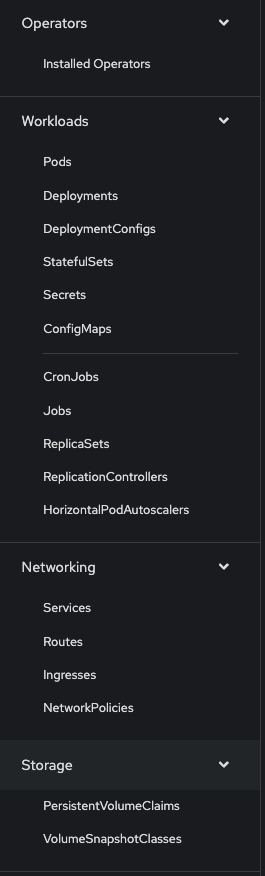
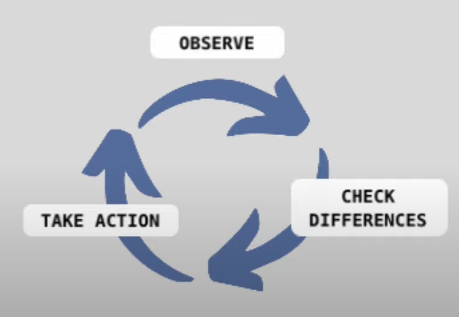
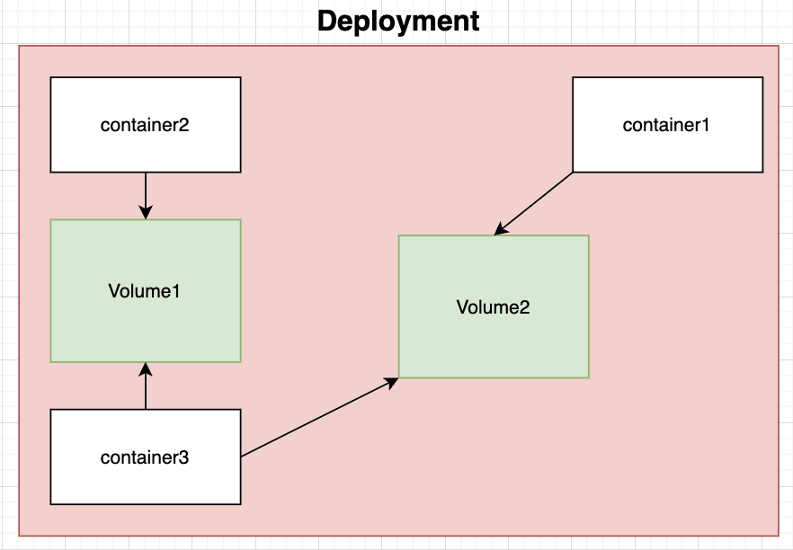

# Kubernetes

Topics:
* Main concepts
* Manifests
* Statefulsets
* HPA
* Clusters
* Networking
* Volumes
* [ There are other topics covered by this document. complete the lis]

Kubernetes or k8s is container orchestration tool. The operating system of Clouds!

It is "Declarative" because It is always running a **Control loop**. 

In this document I want to talk about what to do exactly with k8s.

K8s and almost all other container orchestrator use a linux kernel feature called **CFS**. 
CFS handles resource allocations and enforce limits for runing containers.

###  To learn : 
* service account : which is a fake account 
* api server 
* Headless services
* Node exporter - which has metricss
* Kustomization

grpc load balancing : 
* kube resolver 
* connection pool

grpc just sends a single TCP connection and handles every thing in it . like redis pipe. 

To learn : 
- CRD

## Architecture

The architecture is pretty simple (from 10000 feet overview): **Couple of Master nodes, A lot more of Worker nodes**.

Those master nodes are called "Control Plane", the **brain** of the k8s.

You send instructions to Control plane. The control plane **schedules** the workload. Control plane is on master nodes. 

## Control plane (Master Nodes)

Components:
- API server: The reciever of `kubectl` commands.
- Scheduler: Assigns pods to the appropriate node in the cluster. 
- Controller Manager
- etcd

### Worker nodes

Components:
- kubelet: Talking to master node
- Container engine

Worker nodes are divided into **node pools**. The nodes in a single node pool are all the same. 

Node pools can have different configurations:
- Hardware Specs:
    - 5 general-purpose nodes for web apps (e.g., 4 vCPU, 16 GB RAM)
    - 10 memory-optimized nodes for databases/Redis
    - 3 GPU-enabled nodes for AI/ML workloads.
- CPU Architecture: Mixture of x86 (Intel/AMD) and ARM-based instances (e.g., GCP Tau ARM, AWS Graviton) to optimize costs.
- Pricing Models: Stable On-Demand instances for core services alongside discounted Spot VMs for fault-tolerant batch processing.

Scheduling Mechanisms
- **nodeSelector** & **nodeAffinity**: Directs pods to specific nodes based on key-value labels (e.g., gpu=true).
- **Taints** & **Tolerations**: Prevents unauthorized pods from scheduling on restricted nodes unless explicit tolerations exist.

### Kubelet

Kubelet is a deamon on each node which is responsible for pods health.

### Network

K8s does NOT implement the Network. 


## K8s administration

You can run k8s anywhere. It's so much flexible. We can run it self-managed (On-premise), or in Cloud, Hybrid cloud, etc. Using it on cloud platforms with sth called I think "Managed Kubernetes", it's easier. 

In self-managed k8s you have to manage k8s setup and configuration, upgrades, observability and ... which have a lot of overhead. 

Kubernetes Services:
- GKE (For GCP)
- EKS (Amazon)
- AKS (For Azure)
- Openshift

In a managed kubernetes, even the k8s admins **don't** have access to control plane, but they have Full cluster-level administrative access through different APIs and configurations to change them.


| Feature / Access Type | Self-Hosted Kubernetes (On-Prem / Bare Metal) | Managed Kubernetes (GKE / EKS / AKS) |
| --- | --- | --- |
| **SSH access to Master Nodes** | Allowed | **Not Allowed** |
| **Direct etcd database manipulation** | Allowed | **Not Allowed** (Managed by Cloud Provider) |
| **Full `kubectl` cluster-admin access** | Allowed | Allowed |
| **User access control & RBAC management** | Allowed | Allowed |
| **Direct modification of `/etc/kubernetes` files** | Allowed | **Not Allowed** (Configured via Cloud Console/API) |

Worker nodes can be autoscaled. Read about it in GCP document. 

## Main resources

You can see main concepts of k8s in the k8s dashboard : 



You can get the information of an object using `describe` commands. 
```bash
oc describe [object type] [object type]
```

For example:
```bash
oc describe project automation-test
```

### Kubernetes resources which run pods

#### 1. Native Workload Controllers
* **Deployments:** Stateless workloads (e.g., Web APIs, Microservices).
* **StatefulSets:** Stateful workloads requiring persistent identity/storage (e.g., PostgreSQL, MongoDB, Redis clusters).
* **DaemonSets:** Pods running on every node (or selected nodes) across the cluster (e.g., Fluentd log collectors, Datadog agents).
* **ReplicaSets:** Underpinning controllers managed automatically by Deployments.

#### 2. Batch & Job Controllers
* **Jobs:** Workloads meant to execute once to completion (e.g., DB migrations, data processing scripts).
* **CronJobs:** Scheduled recurring jobs (e.g., nightly backups, periodic cleanup scripts).

#### 3. Individual Unmanaged Pods
* **Standalone Pods:** Naked pods created directly without a parent controller (not recommended for production, but monitored here).

#### 4. Custom Resource Definitions (CRDs)
* **Operator-managed Workloads:** Custom resources defined by Kubernetes Operators (e.g., Argo Workflows, Prometheus Operator instances) that manage pod lifecycles.

### Level of abstraction 
Pod is the atomicity of kubernetes . 

Pod → Deployments → namespace → TEAM

* in openshift instead of **namespace** we have **project**.

Each of these are k8s clusters. we can get the list of them in cli using : 

```bash
get <resource name>s
```
For almost all of these resources the `oc` (or `kubectl`) has `get` and `delete` commands.

### Limits

When a pod is in the `pending`state, the first thing that comes to our mind is that there is no node which has the required RAM of CPU. but, the other probability is that we determined the limits inefficiently. 

Limits say two important things about our workload:
- The required resources to run ( for the scheduler ), which is `requests`
- The maximnum resources that it can consume ( for the kubelet), which is `limits`

```
spec:
    containers:
        requests: 
            cpu: 10m 
            memory: 50Mi
        limits:
            cpu: 100m
            memory: 100Mi  
```

For cpu the unit is 'm' and for the memory is 'Mi'. 'Mi' is representation for **Mebibyte** which is closely related to megabyte (2^20).

> If you do not set the requests value, The k8s will default it to the value of your **limits**. 

So, for example if your limit memory is 100Mi and you don't have any request, the k8s considers your request 100Mi. 

Limits are in linux features. In linux when a process gets to its limit, its being considered as a candidate for kernel to free up the memory (as you might know, linux doesn't kill a process immediately and it makes a candidate and elects).

Inspecting cgroups in K8s pods: 
```bash
ls -l /sys/fs/cgroup/memory/kubepods/burstable/<pod id >
```


### Service 

If you want expose a pod to the outside world, you have to put it behind a service. It's dangerous to put the pod out on it's own.

Service is an abstraction layer over pods. You can access pods through their assigned service. 

It has some key points :

- Stable ip address : Pods' ip addresses change contantly, but a service's ip address & DNS name is constat all the time and other connections can be made to it. 
- Load balancing
- Headless services: K8s supports headless services which returns the IP address of a pod, then then other services can **directly** interact with that pod. 

- Service Types: 

```
kubectl expose deployment hello-world-rest-api --type=LoadBalancer --port=8080
```
In OKD we use `oc` instead of `kubectl`.

- Service discovery

### HPA
It stands for Horizontal pod autoscaler. K8s handles highly-availability in a great level. For autoscaling we use k8s.

Without it, we set the number of instances manually in the deployment file or in our commmands. But the number of required instances may change and not be a constant value. In these cases, we use **Autoscaling**. 

Autoscaling deployments:
```bash
kubectl autoscale deployment hello-world-rest-api --max=4 --cpu=70%
```

Put at least 2 pods for a service to HA that service. But if the requests to our service is going to grow we need to add more pods.

* Before any scaling we need load-testing and fine-tuning to see whether the service works as we expected or not.

We can create it using the k8s dashboard.

HPA has three parameters:
- min : the minimum count of our pods
- max : the maximum counts
- cpu-percent : This is one of the metrics that k8s decides to scale pods with.

Autoscaling using HPA with CLI:
```bash
oc autoscale deployment/helloworld --min=2 --max=10 --cpu-percent=240
```

## ReplicaSet

It sits **between pod and deployment**. 

It ensures the right number of pods are always running. If you delete a pod, the ReplicaSet would create it back again.

How is it related to deployment?

The role of deployments is to manage the Replicasets. Deployments have versioning, they can be rolled back. Also it has rolling update feature which is out of the scope of a ReplicaSet.

When we update a deployment we are creating a new ReplicaSet. 

Engineers normally don't write yaml files for ReplicaSets.

### Selector 

Selector is the main component of service. 

It is used to identify the set of Pods that the Service should target.

Selector works with labels. If a selector has a set of labels A, it **selects** pods with A labels.

### Labels

Labels are assigned to each object in k8s for querying purposes. With labels we can select objects with desired properties. 

### Other components of service

Other components configures service's behaviour & **connectivity**.

- Cluster IP : used for interacting inside the cluster. 
- Port, Endpoint
- ServiceType
- Service discovery 
- External access

### Role

There are some actions defined on k8s objects. Like reading, editing, etc.

A user or a pod ( e.g. deamonset pod ) can get some of these accesses.

I think due to deamonset mindset, it needs to modify some pods and need some accesses. 


#### Cluster role binding

### CRD's


### Statefulsets

Stateful sets are used for stateful components of our system . 

Components like databases, key-value stores , brokers etc.

For example postgre , mariadb , redis, nats, kafka, prometheus, etcd, etc. 

Replication of databases has some points that are mentioned [here](https://github.com/parsaeisa/Notes/tree/main/Software%20engineering/Database#highly-availability)

StatefulSets require **human operations**. But this facts denies many of k8s main concepts like : 
* automation
* less human intervention
* self healing

So here we need an alternative. Those alternatives suppose to be **operators**.

Kubernetes has **fully automated manner** while manging stateless apps but the concept of operators is defined using StatefulSets. This is because k8s doesn't have required knowledge for managing them.

* stateless apps doesn't have business logic (??)

### Operator

Operator is a software operator instead of human operator.

Operators should do this in a automated manner : 
- deploy the app
- create clusters of APIs
- recover

Operators has a loop : 



Operators can be **custom operators** in  k8s. 

It also watches for changes, changes in configurations such as image's URL.

It uses CRDs which stands for **C**ustom **R**esource **D**efinitions.

Resources are what I called objects in previous. We have resources such as configMaps, deplymetns etc. We can define our custom resources using CRDs. This is just basic understanding of CRDs I explained about it more in CRD section.

* Operators for many applications has been developed already by the community and you can access them using : operatorhub.io

There is also an **operator sdk** that helps to create an operators.

### Routes
We can define routes for connecting to a deployment . We can define only for ourselves and for debugging purposes.

### Volumes

A volume can be created within a project and can be used by pods within that project. Volumes **cannot be shared between projects**, and if a project is deleted, the pods and the volumes within that project will be deleted.

About block storage volumes: 
- Block storage volumes can only be attached to one pod at a time.
- An application that will use a block storage volume has to change for having more reliability and failover.

First you create a volume, then you add it to a Deployment. You can add storage to a Deployment within this way : 

Administrator > Workloads > Deployments > your application > Actions > Add Storage

After adding the storage, a new deployment is being created. Now go to your pod's terminal and run `df -h` to see the free storage in the volume.

Also you can **detach** a volume from your deployment, simply by removing it in Administrator > Workloads > Deployments > your application > Configuration tab.

Volumes can be deleted. 

One example of using volumes in deployments is creating shared files. First you define a volume in your deployment:



```bash
apiVersion: apps/v1
kind: Deployment
spec:
    templates:
        spec:
            volumes:
                - name: shared-file
                  emptyDir: {}
```

Then you add this to one of containers in your deployment: 

```bash
apiVersion: apps/v1
kind: Deployment
spec:
    templates:
        spec:
            containers:
                - name: exampleContainer
                  image: exampleImage
                  volumeMounts:
                    - name: shared-file # The name of volume that your shared files are placed in
                      mountPath: /path/in/container/
                      subPath: /path/in/shared volume/
            volumes:
                - name: shared-file
                  emptyDir: {}
```


### Configmaps

Configmaps are subset of __volumes__.

I don’t know the difference between configmaps and deployment configs . 

A service in k8s reads configuration variables from a config file that is  stored in the k8s itself. 

This is useful when an incident is happening and we want to configure the connections or behavior of system very quickly. Without the need of ( is need correct here?? ) changing the project in source code ( creating branches and merge requests and shit )

#### Adding a config to a project

When you want to run your application with a config file, your default path for config file is probably the root directory. 

In configMaps, the data section, you can define multiple files : 

```bash
data:
    config1.yml: |-
        # configurations
    config2.yml: |-
        # configurations
    config3.yml: |-
        # configurations
```

Then a volume is created in your pod host machine. You can add this volume to your deployment in this way (it's just like mounting a volume with some little differences ) : 

```bash
apiVersion: apps/v1
kind: Deployment
spec:
    templates:
        spec:
            volumes:
                - name: config
                    configMap:
                    name: "app-name"
```

For adding a config file to a container in your deployment do this:

```bash
apiVersion: apps/v1
kind: Deployment
spec:
    templates:
        spec:
            containers:
                - name: exampleContainer
                  image: exampleImage
                  volumeMounts:
                    - name: config # The name of volume that your configMap is placed in
                      mountPath: /path/in/container/
                      subPath: /path/in/config volume/
            volumes:
                - name: config
                    configMap:
                    name: "app-name"
```


#### Secrets  

In our configmaps, we may need to store some passwords . e.g. the username and password for connection to a database . 
These passwords should not be shown in the configmaps . so we store them in secrets to be available merely for administrators.  


## Service account 

This is an account that is used for pipelines in automations.

It has a level of access that can be for example editor.

### Job 

You can define a job for k8s that is executed in a cron job timing . 

#### Using k8s job in a project

You can put an endpoint in your project that has a handler. In this handler you do things that you want to be done on in a scheduled way on a regular basis.

Then in that cronjob, you can make a request to that endpoint ( in bash, curl ) in time regulations that you want.


## Manifests

Each object is defined for k8s in a yml file that I like to call manifest. Manifests are descriptive files.

Files: 
- clusterrolebinding.yaml
- configmap.yaml
- deployment.yaml
- ingress.yaml
- networkpolicy.yaml
- pvc.yaml
- serviceaccount.yaml
- service.yaml

You can create most of these files using `helm create` command. 

It has a structure : 
```
apiVersion: 
kind:
metadata:
    [e.g. names & labels]
spec:
    [other key featues of object]
```

We talk to k8s within manifests. I use **helm** for deploying applications. You can read about helm [here](https://github.com/parsaeisa/Notes/blob/main/DevOps/Helm.md)

## Team

Each team consists multiple namespaces. 

A namespace can be a part of a team to get quota more than usual. 

Namespaces can be joined to teams and being removed from it. 

## Deamonset

Deamonset is used when we want to add a process to every cluster in kubernetes.


## Controllers

## Networking 

Networking is one of the sections in okd dashboard ( administrator mode ) . 

{image}